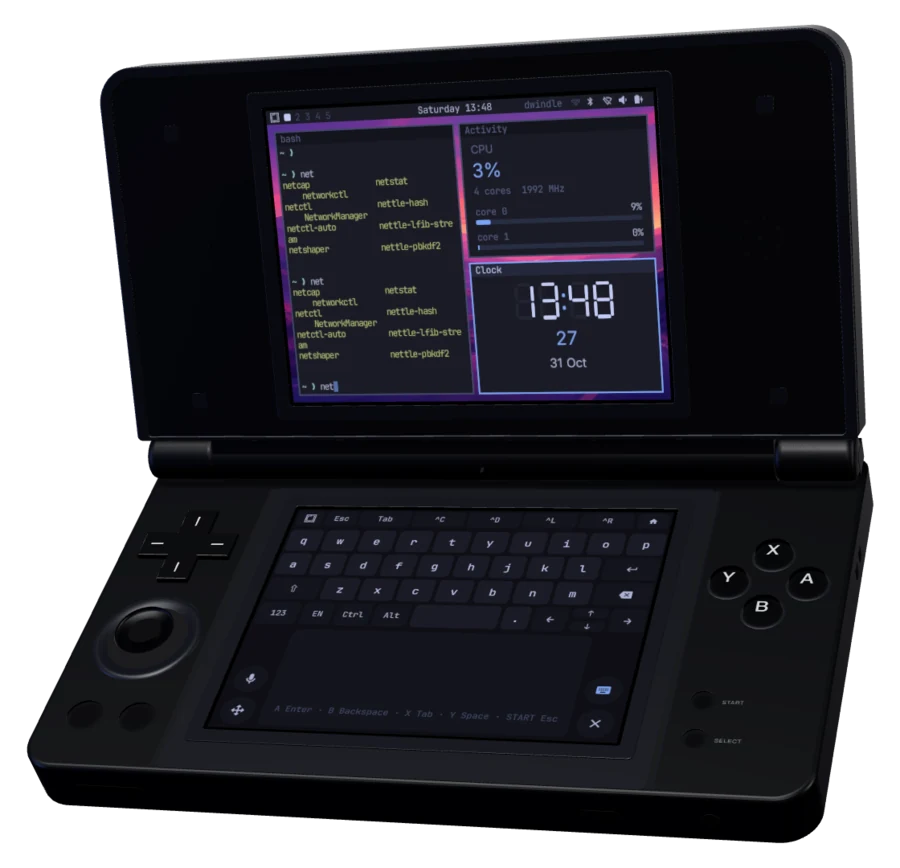
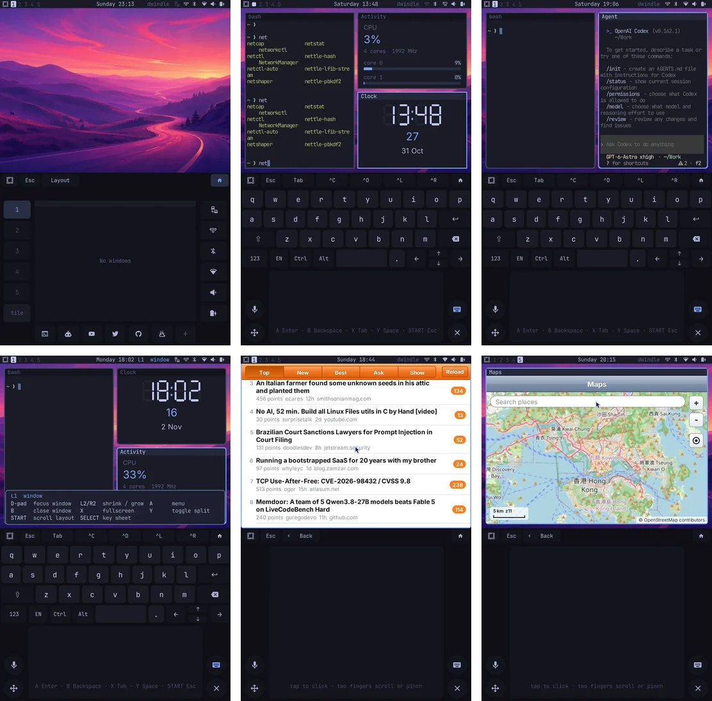
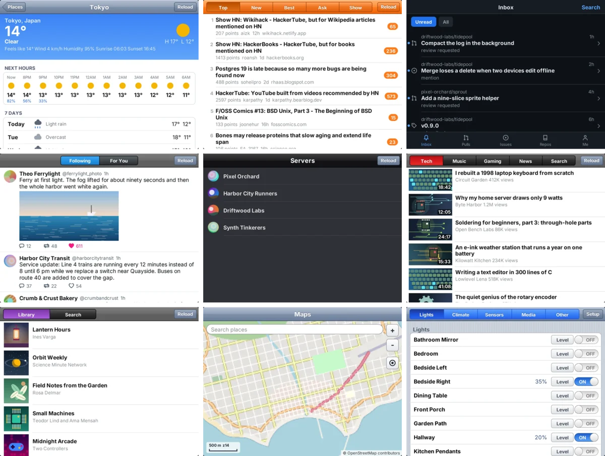

# Omarchy Pocket

<p align="center"></p>

Omarchy's CLI, themes, config and Linux services on the Anbernic RG DS Plus (RK3568, two 1024×768 DSI panels), under one PocketJS shell rendered by the Mali-G52. Omarchy's desktop session (Hyprland, Quickshell, SDDM) is not installed. The site is [omapocket.org](https://omapocket.org), with a [live demo](https://omapocket.org/demo/) of the shell in the browser.

The picture is the device's three.js model (`site/public/kit/rgds.js`) with two captures from the device on its panels, rendered by `site/render.ts`.

## On the device

<p align="center"></p>

Both panels read back from the GPU (`tools/screenshot.ts`), the upper over the lower:

- **Top row:** the desktop with the workspace pad; a terminal, Activity and Clock tiled, over the keyboard deck; Codex in a window.
- **Bottom row:** the window layer's key sheet (hold L1); Hacker News and Maps over the touchpad.

## On the AYN Thor

The AYN Thor (Snapdragon 8 Gen 2, Android 13, a 1920×1080 upper display over a 1240×1080 touch display) runs Omarchy Pocket as an installable Android app: the same shell on both displays at raster density 3 (640×360 points over 413×360), the same host program built as `libomarchy_pocket.so` on the Adreno through EGL, the Odin controller as the gamepad, and Omarchy's CLI with omarchy-pocketd in the RG DS Plus image's Arch Linux ARM root, run by the app under proot. Android stands in for systemd, NetworkManager, PipeWire and BlueZ. [docs/ayn-thor.md](docs/ayn-thor.md) has the details.

```sh
bun tools/android.ts all            # the app: lib, proot, daemon, shell, applets, apk, adb install
bun tools/android.ts rootfs         # the Linux root, from the RG DS Plus image
bun tools/android.ts push-rootfs    # the app installs it at its next start
```

## Applets

<p align="center"></p>

The windows' applets come from [pocket-nexus/applets](https://github.com/pocket-nexus/applets), the source Pocket Shell also builds for the 3DS and the Tab5. The pictures are each applet's first screen on its sample data, in the player at [applets.pocket.nexus](https://applets.pocket.nexus/); the Store applet installs them on the device.

## Documentation and layout

- [docs/omarchy-pocket.md](docs/omarchy-pocket.md): boot chain, card layout, system image, device program, session, bridge and daemon, input, power, network, shell.
- [docs/features.md](docs/features.md): Omarchy's desktop features and where each stands in Omarchy Pocket.
- [docs/device.md](docs/device.md): hardware, partitions, boot chain, kernel and GPU stack of the stock firmware.
- [docs/usb-link.md](docs/usb-link.md): SSH and port forwarding from a Mac over the OTG USB port, with measurements.
- [docs/ayn-thor.md](docs/ayn-thor.md): the AYN Thor as an Android app: displays, the shell's geometry, input, the Linux root under proot, Android in place of the system services.
- [docs/hyprland-on-libmali.md](docs/hyprland-on-libmali.md): Omarchy's Hyprland on the stock kernel through libmali (the first approach, kept as a record).

| Path | Contents |
|---|---|
| `shell/` | the PocketJS shell (Solid) |
| `host/` | omarchy-pocket-host, the device program (Rust); `libomarchy_pocket.so` for the AYN Thor (`src/android.rs`, `src/gpu_android.rs`) |
| `android/` | the AYN Thor's Android app (Java, Gradle), its host profile (`pocket.host.json`) and the Linux root's `start.sh` |
| `daemon/` | omarchy-pocketd (bridge, `omarchy-shell` socket, terminals, the companion's services) and the `hyprctl`/`uwsm`/`omarchy-pocket-term` shims (Bun) |
| `spotify/` | omarchy-pocket-spotify, the Spotify service's program (Rust, on spotatui's modules) |
| `tools/build.ts`, `tools/deploy.ts`, `tools/screenshot.ts` | build the programs, put them on a device over SSH, read both panels back from the GPU |
| `tools/android.ts` | the AYN Thor's app, its applets and its Linux root; `exec` runs a command in the root over adb |
| `tools/omarchy-assets.ts` | Omarchy's menu, theme, wallpaper and fonts for the shell, from the pinned rc packages |
| `image/build-root.ts`, `image/install.ts` | the system image and its installer |
| `device/` | files for the Omarchy root (`rootfs/`) and the stock root (`stock/`: boot chooser, rescue USB link) |
| `pkg/omarchy-pocket-headless/` | provides Omarchy's desktop-session dependencies |
| `tools/usb-link/` | `usbmux.py` (device) and `usb-mux.ts` (Mac, Bun + libusb) |
| `experiments/hyprland-libmali/` | the Hyprland spike and the patched Hyprland package |

The PocketJS framework, compiler, Linux drivers and the worker runtime come from `vendor/pocketjs`, a submodule at a commit of pocket-nexus/pocketjs main; the host crate, the shell and the tools import from it, and its tools need Bun 1.4.2. The companion's services (the `https://companion.pocket/<service>/` providers, the owner setup, `Supervised`) come from `vendor/pocket-hub`, a submodule of pocket-nexus/pocket-hub (private) with its own `vendor/pocketjs`: `git submodule update --init vendor/pocket-hub && git -C vendor/pocket-hub submodule update --init vendor/pocketjs`. The applets the shell opens in its windows come from `vendor/applets`, a submodule of [pocket-nexus/applets](https://github.com/pocket-nexus/applets): the same source Pocket Shell builds for the 3DS and the Tab5 ([docs/applets.md](docs/applets.md)). `git submodule update --init vendor/pocketjs vendor/applets` (not recursive: the applets build with this repository's PocketJS), then `bun install --cwd vendor/pocketjs --frozen-lockfile` and `POCKETJS_ROOT=vendor/pocketjs bun vendor/applets/tools/setup.ts`.

Pocket Term's grid and key code come from `vendor/pocket-term`, a submodule (`git submodule update --init vendor/pocket-term`, not recursive); `tools/build.ts daemon` installs the daemon's own dependencies (`daemon/package.json`: the libghostty VT core).

```sh
bun tools/omarchy-assets.ts                    # Omarchy's menu, models, palette, wallpaper, fonts
bun tools/build.ts libs root@<device>          # once: libmali for the linker
bun tools/build.ts all                         # host, shell package, daemon, spotify, applets
bun tools/deploy.ts root@<device>              # install and restart on a running device
bun tools/screenshot.ts root@<device> out.png  # both panels from the GPU
```
