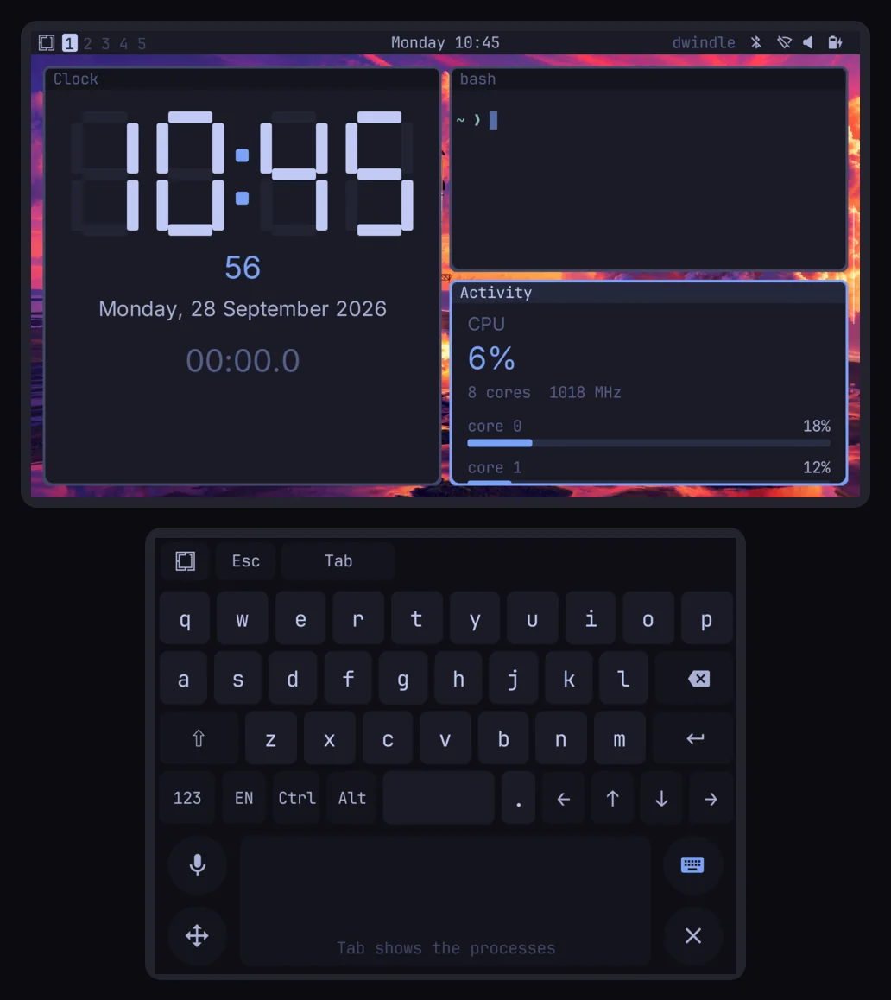

# Omarchy Pocket on the Retroid Pocket Duo Lite

<p align="center"></p>

The Retroid Pocket Duo Lite (Snapdragon 665, Adreno 610, 4 GB, Android 15) runs the AYN Thor's Android app ([ayn-thor.md](ayn-thor.md)): one APK carries both handhelds' profiles, shell packages and applets, and chooses by the device it runs on. Everything below the app (the host program, proot, the Linux root, omarchy-pocketd, Android in place of the system services) is the Thor's, and that page describes it. This page holds what differs. Lines marked **verified** were checked on a Duo Lite (`trinket`, firmware `RPDuoLite_V1.0.0.223`, Android 15, SDK 35) on 2026-11-14.

The pictures are the device's own displays, read back with `screencap -d`.

## The device

A clamshell: the upper half holds a 5.5" 1920 × 1080 touch display and no controls; the lower half holds a 4.2" 1280 × 960 touch display with every control around it.

| Place on the lower half | Controls |
|---|---|
| left of the display | the D-pad over the left stick |
| right of the display | A B X Y (Nintendo order: X top, Y left, A right, B bottom) over the right stick |
| the display's corners | SELECT top left, START top right, HOME bottom left, BACK bottom right |
| the hinge edge | L1 and R1 at the corners, L2 and R2 inboard of them |
| the front edge | microSD, headphones, USB-C, volume, power |

## Displays and the profile

| | Android display | Pixels | Profile (`android/handhelds/retroid-pocket-duo-lite/`) | Surface |
|---|---|---|---|---|
| Upper (5.5", 400 ppi) | 0, the activity's | 1920 × 1080 | 640 × 360 points at density 3 | primary: the stage |
| Lower (4.2", 381 ppi) | 2, `FLAG_PRESENTATION` | 1280 × 960 | 426 × 320 points at density 3 | auxiliary: the deck |

The runtime requires an auxiliary display of exactly its logical size times the density: the deck's SurfaceView is **1278 × 960** at the display's left edge and the last two columns stay black, as the Thor's last column does. The stage is the Thor's 640 × 360 points, so everything on the upper display is laid out as on the Thor; text is 2.3 mm tall at 12 points.

**The deck at 426 × 320 points** (`shell/src/deck/geometry.ts` takes its sizes from the surface):

- the ten keys are **42.6 points (128 pixels, 8.5 mm)** apart, and four rows of keys leave the trackpad 302 × 96 points under them;
- with the keys folded away the trackpad is **302 × 224 points**, the pins along the bottom between Hold and Close;
- the trackpad's hint breaks at its separators into up to three lines that fit the pad (`shell/src/deck/hint.ts`): Clock's five-part hint takes three at 302 points;
- the lock screen's keyboard and password line fit the 320 points as they are.

**One app for both handhelds.** `Handheld.java` matches `Build.MODEL` (`Retroid Pocket Duo Lite`, `AYN Thor`); on another device it takes the profile whose lower surface fits a presentation display. The activity and the presentation size their SurfaceViews from it, `Assets` copies `assets/handhelds/<id>/omarchy-pocket.pocket`, `Linux.prepare` installs `assets/handhelds/<id>/applets/` into the root, and `Native.start` names the profile id to the library, which carries both profiles (`host/build.rs` `HANDHELDS`). A package is admitted on the profile it was compiled for (its hash), so `tools/android.ts shell` and `applets` build each handheld's. The shell packages and applets deflate to a tenth in the APK: **11.4 MB** with both handhelds, against 65 MB for 0.2.0 with one.

## Input

The controls arrive as the **Retroid Pocket Controller** (USB vendor 0x2022, product 0x3001, Android's `Vendor_2022_Product_3001.kl`), which `Gamepad.java` maps by Android's labels as on the Thor:

| Controller | Android | PocketJS |
|---|---|---|
| `BTN_SOUTH` / `EAST` / `NORTH` / `WEST` | `BUTTON_A` / `B` / `X` / `Y` | CIRCLE / CROSS / TRIANGLE / SQUARE |
| `BTN_TL` / `TR`, `BTN_TL2` / `TR2`, `ABS_BRAKE` / `GAS` | `BUTTON_L1` / `R1`, `BUTTON_L2` / `R2`, the analog triggers | LTRIGGER / RTRIGGER, ZL / ZR |
| `BTN_SELECT` / `START` | `BUTTON_SELECT` / `START` | SELECT / START |
| `BTN_DPAD_*`, `ABS_HAT0X` / `Y` | `DPAD_*`, the hat | UP / DOWN / LEFT / RIGHT |
| `ABS_X` / `Y`, `ABS_Z` / `RZ` | the sticks | sticks 0–3 |
| `KEY_HOME`, `KEY_F24` | `HOME` | Android's |
| `KEY_BACK` | `BACK` | consumed: B is the shell's back |

Retroid's quick settings hold a **Controller style** tile, Retro or Xbox; the test unit is on Retro. The shoulder legend (`shell/src/deck/legend.tsx`, `DUO_LITE` in `screen.ts`) draws the controls where they sit: the D-pad over the left stick, the faces in Nintendo order by their printed letters, and SELECT and START as pills at the deck's upper corners, as the buttons sit at the display's upper corners. A confirms, as on the RG DS Plus.

The upper display's touch is not used, as on the Thor: the activity swallows it. HOME stays Android's, with Retroid's own panel behind it.

## Launchers on the lower display

The Duo Lite (and the Thor) show a launcher on the lower display too. A launch from there creates the activity on display 2, and a launch while the shell runs moves its task there. `MainActivity` is `singleTask`: starting itself on display 0 only hands the running instance an intent where it is, and its `finish` then removed the app (0.2.0). Now it starts `Relaunch` in a task of its own and removes its task; `Relaunch`, with no window, starts `MainActivity` on display 0 and finishes (`MainActivity.misplaced`, checked in `onCreate`, `onResume`, `onNewIntent` and on a configuration change).

**Verified:** `am start --display 2` with the app stopped, and again with it running on the upper display: the stage comes up on the upper display and the deck on the lower.

## Run-time glyphs

omarchy-pocketd bakes the characters the package lacks into run-time atlases (`daemon/glyphs.ts`). On the Snapdragon 665 a bake of the whole set (3,885 characters, two slots at density 3) takes **about 40 seconds**, against a few on the Thor, and every new character bakes the set again. The daemon's first bake at its start now includes the prompt's symbols (every character of `~/.config/starship.toml`: `❯`, `✗`, the git marks) and the Network panel's lock beside the 3,755 common Chinese characters, so the first terminal waits on no second bake; and a terminal's run-time runs are laid out again when an atlas loads (`shell/src/term/grid.tsx`), so a prompt drawn during the bake shows its glyph afterwards instead of a box.

**Verified:** with the glyph cache removed, a terminal opened 15 seconds after the start shows `~ ❯` once the first bake finishes (40 seconds after the start), with no further input.

## Verified

On the release build (signed with the release key) and a debuggable build, with input injected over adb (`input keyevent`, `input -d 2 swipe` on the deck, `omarchy-shell pocket.input` through `tools/android.ts exec`):

- both displays render on the Adreno 610 at the profile's sizes; the 802 MB root from the 0.2.0 release installs in **about 33 seconds** and omarchy-pocketd connects;
- L1 + A opens Omarchy's menu; Apps opens Activity (8 cores, their load and clock), Clock and Discord, tiled; Discord reaches its companion service (the setup instructions, not a refusal);
- the deck's keys type `ls` and Return into a terminal; the screen going off locks the shell, and `omarchy` typed on the deck with A unlocks it;
- the Network panel turns Wi‑Fi on and off (`cmd wifi status`), asks for location on the upper display, and lists the scan with signal and lock marks;
- the volume key shows the OSD at 40%;
- L1 held (`input keyevent --longpress`) draws the legend in the Duo Lite's layout;
- frame intervals during the menu's transitions (`dumpsys SurfaceFlinger --latency`): **median 16.7 ms**, the first frame or two of a transition 33–50 ms;
- the release APK installs over 0.2.0 on an AYN Thor and keeps its root; the Thor still comes up as `ayn-thor` with its own deck and legend, and X reaches its companion service.

Not verified: a physical press of any control (every press went through Android's input as an injected key event, which `Gamepad.java` receives as it receives the controller's), the controller's Xbox style, joining a network (no passphrase for one in range), applets over the network (the test unit had no network), sound and Bluetooth.

## Install

From a release after 0.2.0 (0.2.0's APK carries the Thor's profile only, and squeezes it onto the Duo Lite's lower display): download `omarchy-pocket-<version>.apk` and `omarchy-pocket-root.tar.zst` onto the Duo Lite, install the APK, open Omarchy Pocket, press START and choose the root. The lock screen's password is `omarchy`. The app shows in Retroid's launcher and in Android's.

From source, with the Duo Lite on adb:

```sh
export ANDROID_SERIAL=<the Duo Lite's serial>   # adb devices -l: model:Retroid_Pocket_Duo_Lite
bun tools/android.ts all            # lib, proot, daemon, shell, applets (both handhelds'), apk, install
bun tools/android.ts push-rootfs    # the app installs the root at its next start
bun tools/android.ts apk --debug && bun tools/android.ts install --debug   # for tools/android.ts exec
```

**Logs.** This firmware's logcat keeps only error lines from apps, so the host's lines (tag `omarchy-pocket`) do not show; omarchy-pocketd's output is in the app's `files/linux/pocketd.log` (`adb shell run-as dev.pocketnexus.omarchy cat files/linux/pocketd.log` on a debuggable build). The log buffer is 256 KB by default and proot's SELinux audit lines fill it during the root's install; `adb logcat -G 16M` keeps more until the next boot.

## Limits

- The Thor's: programs in the root play no sound (Android's volume and mute work), proot reaches no microphone, and a network Android's own settings saved is forgotten in Android's panel.
- The first start bakes run-time glyphs for about 40 seconds; CJK text and the prompt's symbols show from then on.
- The legend's letters assume the Retro controller style, the test unit's; the Xbox style was not tried.
